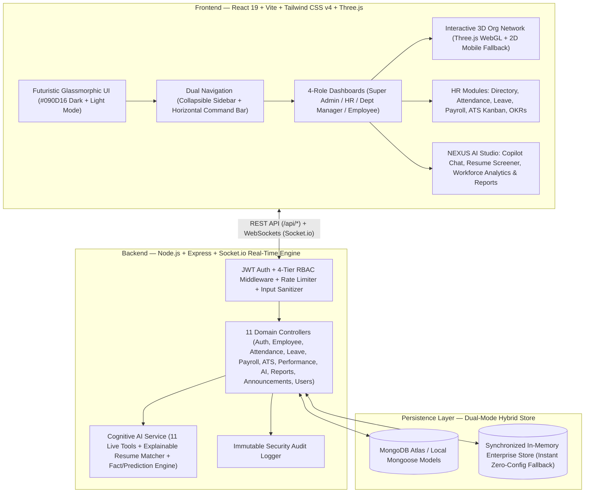

# NEXUS — Next-Gen 3D Digital Workplace & Enterprise Employee Management System

**NEXUS** is a full-stack, AI-powered 3D Digital Workplace and Enterprise Human Resource Management System (HRMS) built with **React 19**, **Three.js (WebGL)**, **Tailwind CSS v4**, **Node.js / Express**, **Socket.io**, and **MongoDB** (with an instant zero-config In-Memory Enterprise Store fallback).

---

## 🏗️ System Architecture Diagram



---

## ✨ Key Enterprise Modules & Features

### 1. Futuristic Enterprise UI & Dual Navigation
- **Dark Futuristic Theme (`#090D16`)** with glassmorphic surfaces, subtle neon accents, micro-interactions, and a persistent **Dark/Light Mode Toggle**.
- **Sidebar + Horizontal Navigation Switcher**: Switch between a modern collapsible left sidebar and the top horizontal command bar at any time.

### 2. 4-Tier Role-Based Authentication & Governance
- **Roles**:
  1. **Super Admin (`admin`)**: Full system control, RBAC permission matrix, user provisioning, and security audit logs.
  2. **HR Administrator (`hr`)**: Workforce directory, recruitment ATS, configurable payroll rules, leave/attendance approvals, and announcements.
  3. **Department Manager (`manager`)**: Dedicated Manager Command Center, direct-report attendance regularization & leave approvals, OKR assignment, and interview feedback.
  4. **Employee (`employee`)**: Self-service check-in/out, regularization requests, leave applications, PDF salary slips, self-assessments, and AI HR Assistant.

| Role | Demo Email | Demo Password |
| :--- | :--- | :--- |
| **Super Admin** | `admin@nexus.com` | `password123` |
| **HR Administrator** | `hr@nexus.com` | `password123` |
| **Department Manager** | `manager@nexus.com` | `password123` |
| **Employee** | `employee@nexus.com` | `password123` |

### 3. Interactive 3D Organizational Network (`/org-network`)
- Built with **Three.js WebGL**: Renders all employees as interactive 3D nodes arranged in concentric hierarchy rings (`CEO → VPs/Directors → Senior ICs`) with department cluster coloring and role-based geometry.
- **Interactive Raycasting**: Click any 3D node to inspect the employee's profile, highlight their full upward/downward reporting chain in glowing emerald, filter by department/designation/manager, or toggle to the **2D Organizational Chart Fallback** for mobile devices.

### 4. Complete Core HR Suite
- **Employee Management**: Full CRUD, reporting manager assignment, emergency contacts, qualifications, **Document Vault** (upload/verify/delete), **Activity History Timeline**, activate/deactivate toggle, search, multi-filters, and pagination.
- **Attendance Management**: Timestamp check-in/out, duplicate check-in prevention, working hours & late tracking, **Attendance Regularization Workflow**, and **Official Public Holiday Calendar**.
- **Leave Management**: Leave application, automatic balance deduction, Manager/HR approval queue, and **Team Leave Calendar**.
- **Configurable Payroll Hub**: Dynamic salary structure rules (`Basic %`, `HRA %`, `Allowances %`, `PF %`, `Professional Tax`, and `Tax Brackets`), batch monthly cycle generation, and printable **PDF Salary Slips**.

### 5. Recruitment ATS Kanban & Performance Management
- **7-Stage Recruitment Kanban (`/recruitment`)**: `Applied → Screening → Interview → Selected → Offer → Hired → Rejected` with job openings creator, resume upload parser, interview scheduler, interviewer scorecards, and recruitment funnel analytics.
- **360° Performance & OKRs (`/performance/goals`, `/performance/reviews`)**: Employee OKRs, skill development matrix, manager evaluations, **Employee Self-Assessments**, and **Department Performance Benchmarks**.

### 6. Practical AI-Powered HR Suite (`/ai-studio` & `/recruitment`)
- **A. Explainable AI Resume Screening**: Extracts skills, years of experience, and education from resumes; compares against job openings with explainable sub-scores while keeping final hiring decisions under human control.
- **B. Autonomous AI HR Assistant**: Multi-persona conversational copilot with 11 live tools, voice input/output, and role-checked data retrieval.
- **C. AI Workforce Analytics**: Generates management insights while explicitly badging **Verified Database Facts (`VERIFIED FACT`)** vs. **Predictive Heuristics (`AI PREDICTION`)**.
- **D. AI Report Generator**: Creates executive and department-wise summaries exportable in **PDF** and **CSV**.

---

## 🚀 Quick Start & Running Instructions

### Prerequisites
- **Node.js** v18+ and **npm**
- *(Optional)* **MongoDB** (if `MONGO_URI` is not provided or unreachable, NEXUS automatically runs on its pre-seeded In-Memory Enterprise Store with zero configuration).

### 1. Install Dependencies
```bash
# Install frontend dependencies
npm install

# Install backend dependencies
cd backend
npm install
cd ..
```

### 2. Run the Full-Stack Application (Development)
Open two terminals or run concurrently:

**Terminal 1 — Backend API & WebSocket Server (Port 5000):**
```bash
cd backend
npm start
```

**Terminal 2 — Frontend Vite Dev Server (Port 5173):**
```bash
npm run dev
```

Then open **http://localhost:5173** in your browser.

### 3. Run Verification Tests & Production Build
```bash
# Run automated backend verification suite
node backend/tests/verifyAllModules.js

# Build production frontend bundle
npm run build
```

---

## 📡 API Documentation Summary
When the backend server is running, live interactive API documentation is available at:
- **`GET http://localhost:5000/api/docs`** — Complete endpoint catalog and RBAC schema
- **`GET http://localhost:5000/api/health`** — Real-time system health & database mode telemetry
