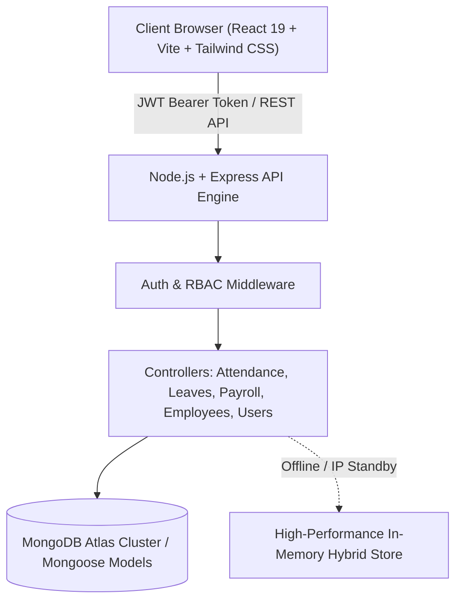

# NEXUS HR — People. Performance. Connected.

> **Production Full-Stack Human Resource Management System (HRMS)** with Role-Based Access Control, Fixed-Time Attendance Automation, Leave Approvals, Salary Computation & Slips, Performance OKRs, and MongoDB Atlas Persistence.

---

## 🌟 Executive Overview

**NEXUS HR** is an enterprise-grade full-stack HRMS built with **React 19 + Vite**, **Node.js + Express**, and **MongoDB Atlas + Mongoose**. Designed for fast-growth tech organizations and enterprise workforces, it features a dark graphite and midnight navy aesthetic, glassmorphism panels, electric blue/violet gradients, mouse perspective tilt, and Three.js visual computing.

---

## 🏛️ System Architecture



---

## 🔐 Three Role-Based Portals

| Role | Permissions & Permitted Actions | Default Demo Account |
| :--- | :--- | :--- |
| **Admin** | Full system governance, User & Role assignment, Office timing policies & grace limits, Organization analytics & audit logs. | `admin@nexus.io` / `Admin@123` |
| **HR Lead** | Employee CRUD, Attendance monitoring, Leave review & approval queue with feedback, Monthly payroll draft/approval/payout, Company announcements, Performance reviews. | `sarah.chen@nexus.io` / `Hr@123` |
| **Employee** | Daily punch check-in & check-out, Working hours tracker, Leave balance & application with mandatory reason, Confidential salary details & downloadable salary slips, Goals & OKRs. | `marcus.vance@nexus.io` / `Emp@123` |

> 🔒 **Security Guarantee**: Non-HR/Admin employees cannot access another employee's private salary details, payroll computation, or administrative settings.

---

## 🚀 Key Functional Modules

### 1. Attendance & Fixed-Time Work Rules
- **Server-Side Timestamping**: Real-time clock with server-calculated working hours.
- **Fixed-Time Policy**:
  - **Office Start Time**: Configurable (Default: `09:00 AM`).
  - **Grace Period**: Configurable (Default: `15 minutes`). Check-ins between 09:00 AM and 09:15 AM are marked **Present**; check-ins after 09:15 AM are marked **Late**.
  - **Attendance Cutoff**: Configurable (Default: `10:30 AM`). Staff without check-in by cutoff are automatically evaluated as **Absent**.
  - **Half-Day Threshold**: Configurable (Default: `< 4 hours` working time).
- **Monthly Attendance Calendar**: Color-coded badges for Present, Late, Absent, Half Day, On Leave, Holidays, and Weekends.

### 2. Leave Management & Approval Engine
- **Leave Types**: Casual, Sick, Earned, Unpaid.
- **Rules**: Mandatory leave reason, date validation, overlap prevention, real-time balance deductions.
- **Approval Queue**: Dedicated HR modal to approve or reject with qualitative review comments.

### 3. Payroll & Printable Salary Slips
- **Automated Formula**:
  - $\text{Gross Salary} = \text{Basic Salary} + \text{HRA} + \text{Allowances} + \text{Bonus}$
  - $\text{Net Salary} = \text{Gross Salary} - \text{Deductions}$
- **Batch Processing**: Prevents duplicate payroll runs for the same employee within the same pay period.
- **Lifecycle**: `Draft` $\rightarrow$ `Approved` $\rightarrow$ `Paid`.
- **Salary Slips**: Professional printable and downloadable slips (`window.print()`) with company header, component breakdown, and statutory details.

### 4. Performance & Milestone Goals (OKRs)
- **Multi-Criteria Evaluations**: Technical Execution, Leadership, Teamwork, Communication, Delivery Velocity.
- **Qualitative Feedback**: Highlight strengths and improvement objectives.
- **Milestone Goals**: Interactive sliders for tracking progress percentages towards quarterly deadlines.

### 5. Announcements & Notifications
- Pinned priority bulletins, category badges (General, Holiday, Meeting, Policy Update, Urgent Notice).
- In-app notification center with read/unread tracking and real-time toast feedback.

---

## 🛠️ Tech Stack

- **Frontend**: React 19, Vite, Tailwind CSS, Lucide React, Framer Motion, Recharts, Three.js, Axios, React Router v7.
- **Backend**: Node.js, Express.js, Mongoose, JWT (`jsonwebtoken`), Bcrypt (`bcryptjs`), CORS, Dotenv.
- **Database**: MongoDB Atlas (Cloud Cluster) with graceful in-memory standby fallback for seamless offline operation.

---

## 💻 Local Setup & Installation

### Prerequisites
- Node.js v18+ installed
- Git installed
- MongoDB Atlas account (optional, fallback engine active by default)

### 1. Clone & Install Dependencies

```bash
# Clone the repository
git clone https://github.com/Kushalraj123/Employee-Management-System.git
cd Employee-Management-System

# Install Frontend dependencies
npm install

# Install Backend dependencies
cd backend
npm install
cd ..
```

### 2. Configure Environment Variables

**Frontend (`.env` in root):**
```env
VITE_API_URL=http://localhost:5000/api
```

**Backend (`backend/.env`):**
```env
PORT=5000
MONGODB_URI=mongodb+srv://<username>:<password>@cluster0.example.mongodb.net/nexus_hr?retryWrites=true&w=majority
JWT_SECRET=nexus_hr_enterprise_super_secret_jwt_key_2026_x99!
FRONTEND_URL=http://localhost:5173
NODE_ENV=development
```

> 💡 **MongoDB Atlas IP Whitelist**: In your MongoDB Atlas Console, go to **Network Access** $\rightarrow$ **Add IP Address** $\rightarrow$ select **Allow Access From Anywhere (`0.0.0.0/0`)** so your local machine and Render servers can connect.

### 3. Seed Database (Optional)

```bash
cd backend
npm run seed
cd ..
```

### 4. Run Locally

Open two terminal windows:

**Terminal 1 (Backend Server):**
```bash
cd backend
npm run dev
# Server runs at http://localhost:5000
```

**Terminal 2 (Frontend Client):**
```bash
npm run dev
# Vite runs at http://localhost:5173
```

Navigate to `http://localhost:5173` in your browser. You can use the **1-Click Demo Evaluation buttons** on the login page or enter credentials manually:
- **Admin**: `admin@nexus.io` / `Admin@123`
- **HR**: `sarah.chen@nexus.io` / `Hr@123`
- **Employee**: `marcus.vance@nexus.io` / `Emp@123`

---

## 🌐 Production Deployment Guide

### Deploy Backend on Render

1. Create a **Web Service** on [Render](https://render.com).
2. Connect your GitHub repository.
3. Set **Root Directory** to `backend`.
4. Set **Build Command** to `npm install`.
5. Set **Start Command** to `node server.js`.
6. Add Environment Variables:
   - `PORT`: `5000`
   - `MONGODB_URI`: Your MongoDB Atlas connection string
   - `JWT_SECRET`: A secure random secret string
   - `FRONTEND_URL`: Your Vercel frontend URL
   - `NODE_ENV`: `production`

### Deploy Frontend on Vercel

1. Import your GitHub repository on [Vercel](https://vercel.com).
2. Set **Root Directory** to `./` (root).
3. Set **Build Command** to `npm run build`.
4. Set **Output Directory** to `dist`.
5. Add Environment Variable:
   - `VITE_API_URL`: `https://your-backend-service.onrender.com/api`
6. Click **Deploy**.

---

## 📚 API Endpoints Summary

| Module | Method | Endpoint | Access |
| :--- | :--- | :--- | :--- |
| **Auth** | `POST` | `/api/auth/login` | Public |
| **Auth** | `POST` | `/api/auth/demo-login` | Public |
| **Auth** | `GET` | `/api/auth/me` | Authenticated |
| **Employees** | `GET` | `/api/employees` | Authenticated |
| **Employees** | `POST` | `/api/employees` | HR / Admin |
| **Employees** | `GET` | `/api/employees/:id` | Authenticated |
| **Employees** | `PUT` | `/api/employees/:id` | HR / Admin |
| **Employees** | `DELETE` | `/api/employees/:id` | HR / Admin |
| **Attendance** | `POST` | `/api/attendance/check-in` | Authenticated |
| **Attendance** | `POST` | `/api/attendance/check-out` | Authenticated |
| **Attendance** | `GET` | `/api/attendance/today` | Authenticated |
| **Attendance** | `GET` | `/api/attendance/my-history` | Authenticated |
| **Attendance** | `GET` | `/api/attendance/all` | HR / Admin |
| **Attendance** | `GET` / `PUT` | `/api/attendance/policy` | HR / Admin |
| **Leaves** | `POST` | `/api/leave/apply` | Authenticated |
| **Leaves** | `GET` | `/api/leave/my-leaves` | Authenticated |
| **Leaves** | `GET` | `/api/leave/all` | HR / Admin |
| **Leaves** | `PUT` | `/api/leave/review/:id` | HR / Admin |
| **Payroll** | `POST` | `/api/payroll/generate` | HR / Admin |
| **Payroll** | `GET` | `/api/payroll/list` | HR / Admin |
| **Payroll** | `GET` | `/api/payroll/my-slips` | Authenticated |
| **Payroll** | `GET` | `/api/payroll/slips/:id` | Authenticated (Owner / HR / Admin) |
| **Announcements**| `GET` / `POST` | `/api/announcements` | Authenticated / HR |
| **Performance** | `GET` / `POST` | `/api/performance/reviews`| Authenticated / HR |
| **Goals** | `GET` / `POST` | `/api/performance/goals` | Authenticated |
| **Users** | `GET` / `POST` | `/api/users` | Admin Only |
| **Reports** | `GET` | `/api/reports/summary` | HR / Admin |
| **Settings** | `GET` / `PUT` | `/api/settings` | Admin Only |
| **Notifications**| `GET` / `PUT` | `/api/notifications` | Authenticated |

---

## 📄 License
This project is licensed under the MIT License. Built with ❤️ for enterprise workforce management.
